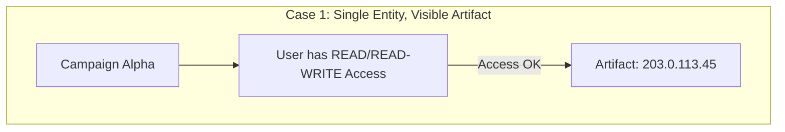
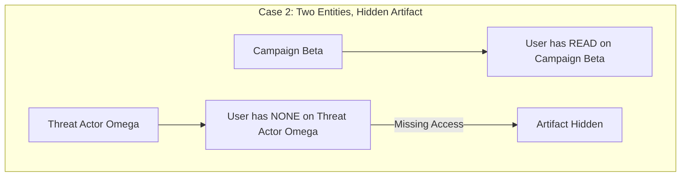
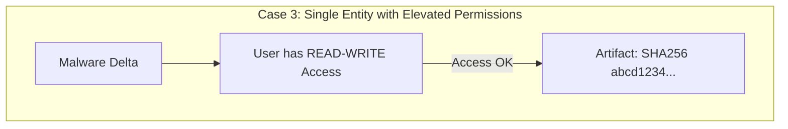
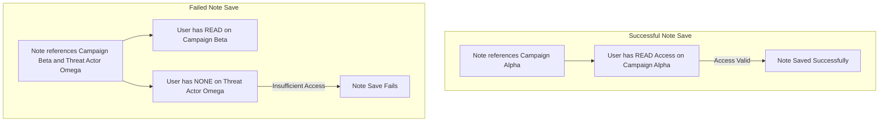

+++
title = "Users and Access"
date = "2025-03-05T12:55:52+01:00"
draft = false
weight = 2
+++

CRADLE implements an entity-level access control system to manage which entries
and notes users can access. The system is built on a strict permission model
with three access levels.

## Access levels

| Access level | Capabilities |
| --- | --- |
| None (default) | Cannot view notes referencing the entity and cannot create notes referencing the entity. |
| Read | Can view notes referencing the entity but cannot create notes referencing the entity. |
| Read-write | Can view notes referencing the entity and can create notes referencing the entity. |

## Key rules

**Note access rule** means a user can view a note only if they have read or
read-write access to all entities referenced in that note. **Default access**
is none unless higher permissions are explicitly assigned. **Superuser
privileges** grant admins read-write access to all entities, and those
permissions are not stored in the database. **Roles** include **admin** (full
permissions and user management), **manager** (entry classes, entity
metadata and access to entities), and **user** (base access for creating and
viewing notes).

## Teams

A **team** is a group of users that is given access to entities. A user can
belong to any number of teams, and users who belong to no team can still be
given access directly. Admins cannot be added to teams, since they can already
access every entity.

A user's **effective access** to an entity is the strongest of their direct
access and the access of every team they belong to. Access only adds up:
joining a team never takes access away, and leaving a team does not remove
the user's direct access. The entity's **Users** tab shows each user's
direct access, their effective access and the teams it comes from.

**Leads** run a team. Any user can be a lead, a team can have several leads,
and a user can lead several teams. Admins create and delete teams and choose
their leads. Leads can rename their team, add and remove members, grant their
team access to entities, and create entities for their team from the team's
**Access** tab. Leads are members too, so they get the same access to entities
as the rest of their team. Leads who are not managers see only the **Teams**
page under **Manage**, plus the **Users** and **Teams** tabs of the entities
their team owns.

An entity can have an **owning team**. An entity a lead creates is owned by
their team; admins set or change the owner on the entity's **Settings** tab. The
owning team is given read-write access, which cannot be lowered while it owns
the entity. Only admins can make an entity public.

## Access management

Nobody can modify access for admins, who can access everything. Read-write
access to an entity does not by itself let a user grant access to it.

| Entity | Who can grant users direct access | Who can grant teams access |
| --- | --- | --- |
| Has an owning team | Admins, and leads of the owning team | Admins, and leads of the owning team |
| Has no owning team | Admins and managers | Admins, and leads of the team being granted access |

Leads can never grant more than their own access to the entity. A lead who
is not a manager cannot raise their own access either, since only managers
grant direct access to entities without an owning team.

**Access requests** let users request access to entities they cannot view.
For an entity with an owning team, that team's leads are notified (admins, if
the team has no leads). For other entities, admins and managers are notified.

## Artifact visibility cases

## Note saving examples

